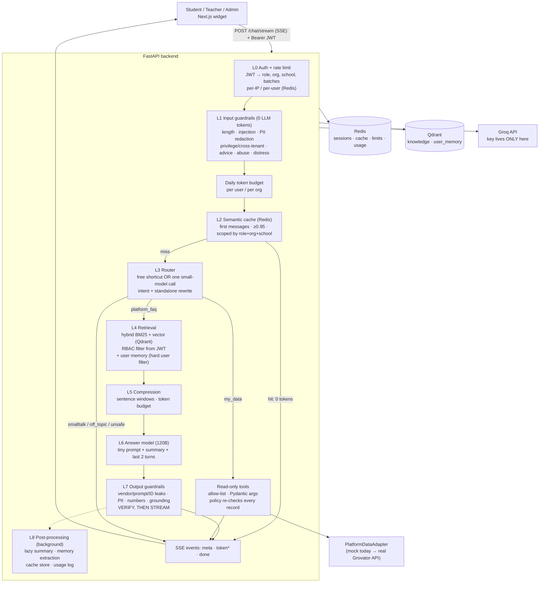

# Grovator AI Assistant

A guardrailed, token-efficient chatbot for **Grovator** (Grok Learning's ed-tech platform). It sits on a course page and
talks about what is on that page and the rest of the platform: courses, lessons, block coding (every block, sample block
programs) and platform tools (workspace, simulator, Connect Kit, debug console...). It remembers the conversation, answers
**only** about the platform, and shows live **how many tokens each answer used compared with a naive bot**.

* **Backend:** FastAPI (async, Pydantic v2, SSE streaming) · **Frontend:** Next.js App Router widget (TypeScript)
* **LLM:** Groq (`openai/gpt-oss-120b` answers, `openai/gpt-oss-20b` router/summary/extraction) via the official SDK
* **RAG + memory:** `fastembed` (bge-small, local), Qdrant, Redis. Free-tier friendly.

> **Read this first: what is real and what is assumed.** This repo was built *without access to the Grovator
> codebase*. The JWT claim shape, the data hierarchy (`org > school > batch > student`), the tool/data schema, and
> the knowledge-base documents are **my assumptions** (see [docs/chatbot/DISCOVERY.md](docs/chatbot/DISCOVERY.md)).
> The knowledge base is the real Grovator ESP32 IoT Gateway dataset (`backend/knowledge_src/hardware/`). The student data and JWT shape are **synthetic/assumed**. Before production you must (1) point the auth
> layer at Grovator's real token format, (2) implement `PlatformDataAdapter` against Grovator's real API/DB, and
> (3) ingest real documentation. The app refuses to start in production with the mock adapter.

## Architecture



Every layer is enforced **in code**, never only in a prompt. The LLM never chooses whose data to fetch: scope comes
from the JWT and is applied by retrieval filters and by `tools/policy.py`.

## Application assistant (pulse oximeter lesson and beyond)

The assistant answers student questions about **applications** (lessons built with the Block Designer and Circuit Designer). The
first one is "Health Monitoring using Pulse Oximeter". Everything it knows about an application is a plain file under
`backend/knowledge/`, so adding content never means changing code.

```
backend/knowledge/
  applications/<slug>/application.yaml   metadata, 5-step guide, logic, thresholds, circuit, program + line-by-line, FAQ
  applications/<slug>/docs/*.md          cleaned text extracted from the decks / PDFs
  sensors/<sensor_id>.yaml               interface, pins, variables, blocks used, how it measures
  blocks/<block_id>.yaml                 title, what it does, code (verbatim), variables
  kits/<kit_id>.yaml                     ports / pins / terminals, what is NOT documented
  media/<id>.yaml + the image            caption, what it shows, related application/sensor/kit, verified: true/false
  GAPS.md                                unknowns and source conflicts for a person to resolve
```

**Add content** (a new application, sensor, block or kit):

```bash
# 1. drop the new files into backend/knowledge/ (copy an existing one, the models are in knowledge/models.py)
cd backend
.venv/bin/python -m knowledge.validate     # checks every file and every cross-reference (a block that does not exist, code that does not parse...)
.venv/bin/python -m ingest.run -v          # validate -> chunk -> embed -> index (QDRANT_URL=memory: dry run, the API re-indexes at start)
# 2. restart the backend. Nothing else changes.
```

How a question is answered (see `app/chat/appkb.py` and `app/chat/service.py`):

| Question | Answer | Tokens |
|---|---|---|
| wiring, which pins, block order, show the code, line by line, thresholds, the 5 steps, common "it shows 0" problems, anything the files do not cover (a kit that is not documented) | built **from the files in code** (wiring table, block stack, code card, "I don't have that detail yet") | 0 |
| other questions about the application | retrieval from the files, grounded prompt, output guard (invented GPIO numbers are blocked) | ~700 |
| general technology / science ("what does SpO2 mean", "what is I2C") | model knowledge in simple words, no sources, never kit pins | ~400 |
| greeting, off-topic, unsafe | fixed replies | 0 |

Rules that are enforced in code, not only in the prompt: pins/ports/blocks/code come from the files; unverified sources (kit photos) are
marked; a mapping that is not documented (pulse oximeter to the Grovator controller) is never invented; whenever readings or health come
up, a "learning project, not a medical device" note is added. The system prompts live in `backend/config/system_prompt.yaml`.

**Evaluate** (`eval/questions.yaml`, 49 questions: steps, wiring, blocks, code, thresholds, general science, messy student wording, health,
off-topic/unsafe, "I don't have that detail" traps):

```bash
# from the repository root, with the backend's Python
backend/.venv/bin/python -m eval.run --offline   # the `det: true` questions only: no LLM, free, deterministic
backend/.venv/bin/python -m eval.run -v          # everything, real model (uses your Groq/Gemini quota; --pace sets the delay)
```

Long-term memory of user facts is **off** by default for this assistant (`ENABLE_LONG_TERM_MEMORY=false`): students are anonymous.
Feedback (thumbs) is also appended to `logs/feedback-<day>.jsonl` with a random request id and no user data.

## Quick start (local demo)

```bash
# backend (needs a Groq key in backend/.env; DEMO_MODE=true lets the demo page log in without a token)
cd backend
uv venv --python 3.11 .venv && uv pip install --python .venv/bin/python -r requirements.txt
cp .env.example .env            # put your GROQ_API_KEY in .env (never in .env.example); keep DEMO_MODE=true
.venv/bin/python -m scripts.list_groq_models          # optional: checks the model names are still available
.venv/bin/python -m uvicorn app.main:app --port 8001

# frontend (new terminal)
cd frontend
cp .env.example .env.local      # set NEXT_PUBLIC_CHATBOT_API_URL=http://localhost:8001
npm install && npm run dev      # open http://localhost:3000
```

Open the page: it logs in as a demo **student**, shows the course content, and opens the chat next to it. Try "Explain this lesson step by step", then follow-ups, then switch lessons or ask about a
block. Watch the **token meter** at the top of the chat.

**Measured proof on live Groq:** `cd backend && .venv/bin/python -m scripts.demo_compare` runs one conversation through
this project and through a naive bot and prints real token counts. No Groq key yet? `uvicorn scripts.serve_fake:app
--port 8765` runs the real app with a deterministic stand-in LLM (dev/E2E only). Port 8000 busy? Use another.

Optional infra for a persistent setup: `docker compose up -d` (Qdrant + Redis), then set `QDRANT_URL`/`REDIS_URL` and run
`python -m scripts.ingest`.

## Embedding the widget in the real Grovator frontend

```tsx
import { ChatWidget } from "@/components/chat";   // copy frontend/src/components/chat + src/lib + src/hooks/useChat.ts

<ChatWidget
  apiUrl={process.env.NEXT_PUBLIC_CHATBOT_API_URL!}
  getToken={() => session.accessToken}   // Grovator's own JWT; the widget never mints or stores it
  pageId={currentDoc.source}              // the content page being viewed: "explain this lesson" works
  suggestions={["Explain this lesson step by step", "What blocks do I need here?"]}
  showTokenMeter                          // live tokens-used vs naive-bot meter (demo / transparency)
  storageKey={user.id}                    // optional: keeps the conversation per user per tab (sessionStorage)
  onAuthError={() => router.push("/login")}
/>
```

Features: page-aware answers, token meter, streaming answers, safe markdown (React elements only: no `innerHTML`, no links, no images), 👍/👎 with
fixed reason chips (no free text, so no uncontrolled PII), **"What I remember"** panel (list / forget one / forget
all), source line, stop button, 1000-char limit, keyboard + screen-reader support, dark mode, full-screen on phones.

## Configuration (backend `.env`)

| Variable | Default | Purpose |
|---|---|---|
| `LLM_PROVIDER` | `groq` | `groq` or `gemini`. With `gemini`, `GEMINI_ANSWER_MODEL` / `GEMINI_ROUTER_MODEL` (default `gemini-3.5-flash-lite`) replace `ANSWER_MODEL` / `ROUTER_MODEL`. List usable names with `python -m scripts.list_gemini_models` |
| `GROQ_API_KEY` / `GEMINI_API_KEY` | – | Key of the chosen provider. **Backend only.** The frontend build is checked to contain no key. |
| `ANSWER_MODEL` / `ROUTER_MODEL` / `GUARD_MODEL` | `openai/gpt-oss-120b` / `-20b` / `-safeguard-20b` | Swap when Groq deprecates a model (`scripts.list_groq_models` checks). The brief's Llama chat models are no longer on Groq. |
| `REASONING_EFFORT` | `low` | gpt-oss hidden reasoning counts as output tokens |
| `JWT_SECRET`, `JWT_ALGORITHM` | dev default, `HS256` | Must match Grovator's token signer. `exp` and `sub` are **required**. |
| `DEMO_MODE` | `false` | `true` enables `POST /demo/session` (login without a token) for the demo page. Refused in production. |
| `SUMMARY_MODE` | `extractive` | `extractive` = free "earlier questions" list (0 tokens); `llm` = small-model summary |
| `ENVIRONMENT` | `development` | `production` enables startup checks (refuses weak/default secrets, mock adapter, in-memory stores, localhost CORS) |
| `REDIS_URL` | `memory` | Sessions, semantic cache, rate limits, budgets, usage counters. `memory` = per-process fake (dev only). |
| `QDRANT_URL` | `memory` | `knowledge` + `user_memory` collections. `memory` = embedded (dev only). |
| `CORS_ORIGINS` | `http://localhost:3000` | Comma-separated. `*` is ignored. |
| `PLATFORM_ADAPTER` | `mock` | `mock` serves FAKE data; `none` disables data tools |
| `RATE_LIMIT_USER_PER_MIN` / `RATE_LIMIT_IP_PER_MIN` | `20` / `60` | 429 + `Retry-After`. `X-Forwarded-For` honoured only with `TRUST_PROXY=true` |
| `DAILY_TOKEN_BUDGET_USER` / `_ORG` | `50000` / `1000000` | Counts every LLM token incl. hidden reasoning; friendly message when exceeded |
| `ENABLE_SEMANTIC_CACHE`, `ENABLE_ROUTER_SHORTCUT`, `LAZY_SUMMARY`, `ENABLE_COMPRESSION` | `true` | Token optimisations; switch off to compare. `CACHE_FOLLOWUPS` stays `false` (see DECISIONS D48). |
| `MIN_RETRIEVAL_SCORE`, `GROUNDING_MIN_SUPPORT` | `0.55`, `0.35` | Calibrated on the synthetic corpus: **re-calibrate on real docs** |
| `USAGE_LOG_DIR` | `logs` | JSONL per request; contains no message text. `""` disables. |

## API

| Endpoint | Who | Notes |
|---|---|---|
| `POST /chat` | any role | `{message, session_id?, page?}` → answer, `request_id`, `sources`, `tokens_total`, `naive_tokens` |
| `POST /chat/stream` | any role | SSE: `meta` → `token`* → `done` (or `error`). Tokens are sent **after** the full answer passed the output guard |
| `POST /chat/feedback` | owner of the request | `{request_id, rating: up\|down, reason?}`; one rating per request, changeable |
| `DELETE /chat/sessions/{id}` | owner | clears short-term context |
| `GET/DELETE /memories`, `DELETE /memories/{id}` | self only | list / forget one / forget all |
| `GET /admin/chatbot/usage?days=&school_id=` | admin (own school), superadmin (own org) | requests, intents, cache-hit rate, tokens by component, avg tokens/request, p50/p95, feedback |
| `GET /content` | any role | the documents this user may read (the page renders them; the bot answers from the same ones) |
| `POST /demo/session` | demo only | `{role: student\|teacher}` → dev token. 404 unless `DEMO_MODE=true` |
| `GET /health` | – | liveness |

## Memory

* **Short-term** (Redis, key includes the user id): rolling summary (≤120 tokens) + last 2 turns, 24 h TTL. A turn is folded into the summary only when it leaves the window.
* **Long-term** (inside the RAG pipeline, `user_memory` collection): 0–3 atomic facts extracted by the small model **only when the user talks about themselves** (free regex gate), PII/health/family/name/injection filtered *before* any write, deduped at cosine > 0.9, capped at 50 per user, retrieved with the same query embedding and **hard-filtered by `user_id` + `org_id`**. Users can list and delete everything.

## Security model (summary)

JWT is the only source of identity → retrieval filters + tool policy (`teacher`→their batches, `admin`→their school, `superadmin`→their org, `student`→self) · read-only allow-listed tools with strict arg schemas · denied == not-found (no enumeration) · input rules block injection/jailbreak/obfuscation/privilege claims/PII requests/SQL-NoSQL-shell · output guard blocks vendor/model names, system-prompt leaks, internal ids, PII, invented marks · verify-then-stream (a leak cannot reach the wire) · rate limits + token budgets · PII redacted before any LLM, log, cache or memory · no raw message text is ever logged · refusal for distress points to a trusted adult · CORS allow-list, bearer auth (no cookies).

## Token efficiency (measured on live Groq)

`python -m scripts.demo_compare` runs one 7-message conversation about a lesson page three ways:

| Bot | Tokens | |
|---|---|---|
| **This project** (cache + free routing + page-aware RAG + compression + 2-turn window + free summary) | **3,677** | measured |
| Naive, open page + whole chat re-sent each message | 7,503 | measured → this project uses **51% fewer** |
| Naive, whole course site + whole chat re-sent each message | ≈ 39,244 | estimated → **91% fewer** |

Per message this project stays flat (about 470 to 700 tokens) while the naive bots grow with the chat. The page-only
naive bot is the fair cheap baseline, but it **cannot answer outside its page** (it said "I don't have that information"
for a question about another course); the whole-site bot can, at ~6.2k tokens per message before the chat history.
What got the cost down: skipping the router call for clear and follow-up questions, a zero-token rolling summary (a list
of earlier questions), sentence-level context compression, a semantic cache for repeated first questions, and a tiny
prompt. The chat's token meter shows the same comparison live for every answer.

Caveats: one conversation, small synthetic corpus (29 pages, 6.2k tokens), a single run each; the whole-site figure is
an estimate. Real sites are larger, which makes retrieval look better, and real traffic has fewer repeated questions,
which makes the cache look worse. Earlier benchmark (Phase 5, different workload): 1,147 to 516 tokens per turn.
Details: [docs/chatbot/DECISIONS.md](docs/chatbot/DECISIONS.md) D39 to D70.

## Eval results (live Groq, `eval/run_eval.py --mode live`, 193 test items)

| Suite | n | Pass | Avg tokens/turn | p95 ms |
|---|---|---|---|---|
| Security: input rules, access control, output guard, memory isolation, knowledge RBAC (offline) | 109 | 100% | – | <10 |
| Security: semantic red team on real models (injection, prompt/identity extraction, cross-tenant) | 28 | 100% | 492 | 1,160 |
| Quality: retrieval (18 hand-written Q&A) | 18 | 100% | – | 7 |
| Quality: answers with correct source (18) | 18 | 100% | 597 | 1,590 |
| Quality: multi-turn follow-ups (5 conversations, 12 turns) | 12 | 100%* | 764 | 1,451 |
| Quality: legitimate requests that must work (8) | 8 | 100% | 463 | 1,004 |
| **Overall** | **193** | **100%*** | **567** | **1,230** |

\* The first full live run scored 192/193: one correct answer was refused by the numeric guard (a tutorial's variable
named `score`). I fixed the cause, added a regression test, and re-ran the affected suites (20/20). I did **not** re-run
the whole 66-turn live eval after the fix. Single runs on a small synthetic corpus: treat as a smoke-level signal.

## Testing

```bash
cd backend  && .venv/bin/python -m pytest -q                  # 467 tests (unit, integration, red team, mutation-hardened)
cd frontend && npm run typecheck && npm test                  # 20 unit tests (SSE parser, safe markdown incl. headings/code, API client)
cd frontend && NEXT_PUBLIC_DEMO=1 NEXT_PUBLIC_CHATBOT_API_URL=http://localhost:8765 npm run build && npm run e2e
                                                              # 16 browser tests: real demo page + widget (headless Chromium) ↔ real FastAPI
cd backend  && .venv/bin/python ../eval/run_eval.py --mode offline      # free, deterministic gates
cd backend  && .venv/bin/python ../eval/run_eval.py --mode live         # real Groq: quality, tokens, latency, semantic red team
```

`eval/` is data-driven (JSONL in `eval/datasets/`): add a line to add a test. It exits non-zero if any **security**
suite is below 100% or a **quality** suite is below 90%, so it can gate CI. I verified the gates by mutation: breaking
the tool policy, input rules, each output-guard rule, memory filters or knowledge filters makes the right suite fail.

## Repository layout

```
backend/app/{api,chat,core,guardrails,llm,memory,rag,tools}   FastAPI app (see the architecture diagram)
backend/knowledge_src/hardware/*.json                           REAL gateway dataset (rendered to docs by app/rag/hardware.py)
backend/tests/fixtures/knowledge_synthetic/                    old dummy docs, kept only as a test fixture
backend/tests/ · backend/scripts/                              pytest suite · ingest, mint_token, benchmarks, live checks
frontend/src/{app,components/chat,hooks,lib} · frontend/e2e/  Next.js widget · browser E2E
eval/{run_eval.py,datasets/}                                   eval harness + test sets
docs/chatbot/{DISCOVERY,DECISIONS,BUGS}.md                     assumptions, 49 design decisions, bug diary
```

## Known limitations

* The student data (mock tools) and JWT claim shape are assumed. The knowledge base is the real gateway dataset, which documents only physical connections and safety rules: no software setup, example code, expected readings or fault diagnosis, no wiring diagrams, and only one product (the gateway; no separate kits). The bot says so instead of guessing (see `docs/chatbot/DECISIONS.md` D74-D80).
* Lexical grounding is a heuristic (calibrated margin is thin: lowest real support 0.44 vs threshold 0.35); expect occasional safe false refusals and re-calibrate on real docs.
* Spaced-letter evasion (`i g n o r e`) and masked profanity are not caught by the deterministic rules; they rely on the router.
* Health/family/name memory filters are keyword rules, not a classifier.
* Groq's free tier is 8,000 tokens/min/model; production traffic needs a paid tier or the optimisations above.
* The widget was verified in headless Chromium (desktop, dark, phone viewport), not on real devices or other browsers.
